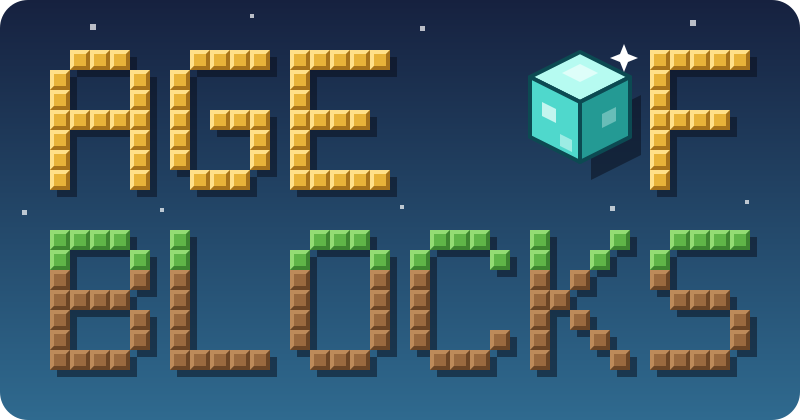
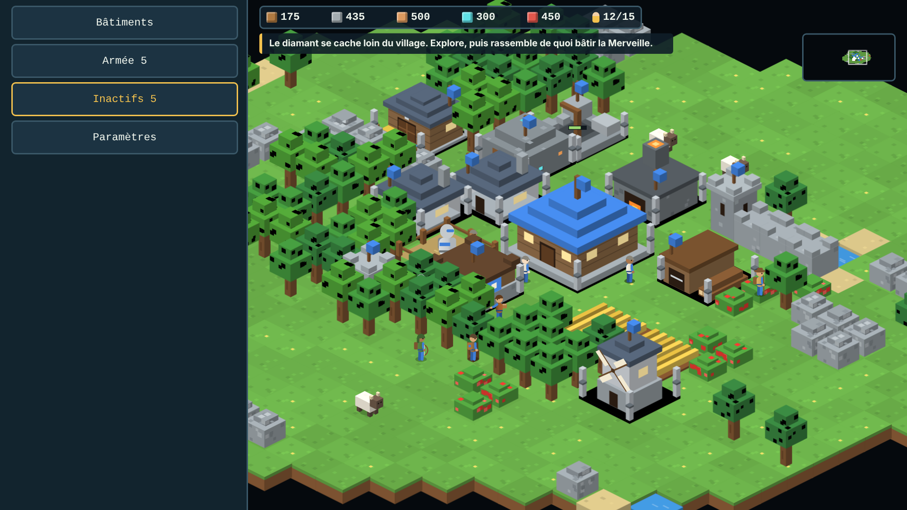
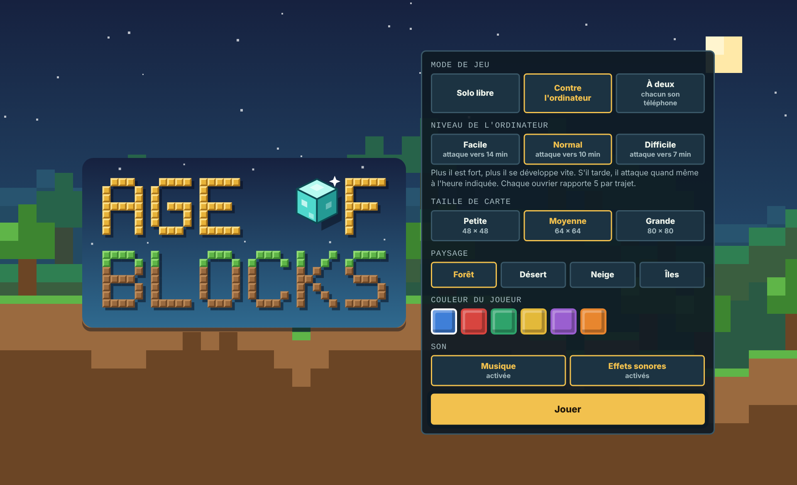
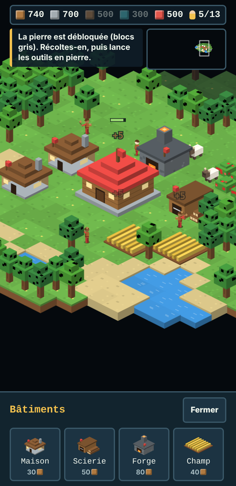
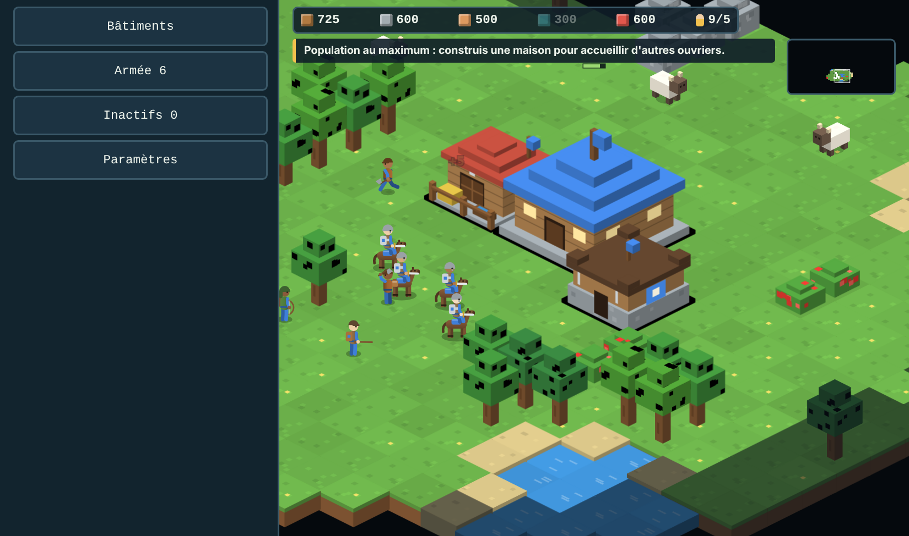
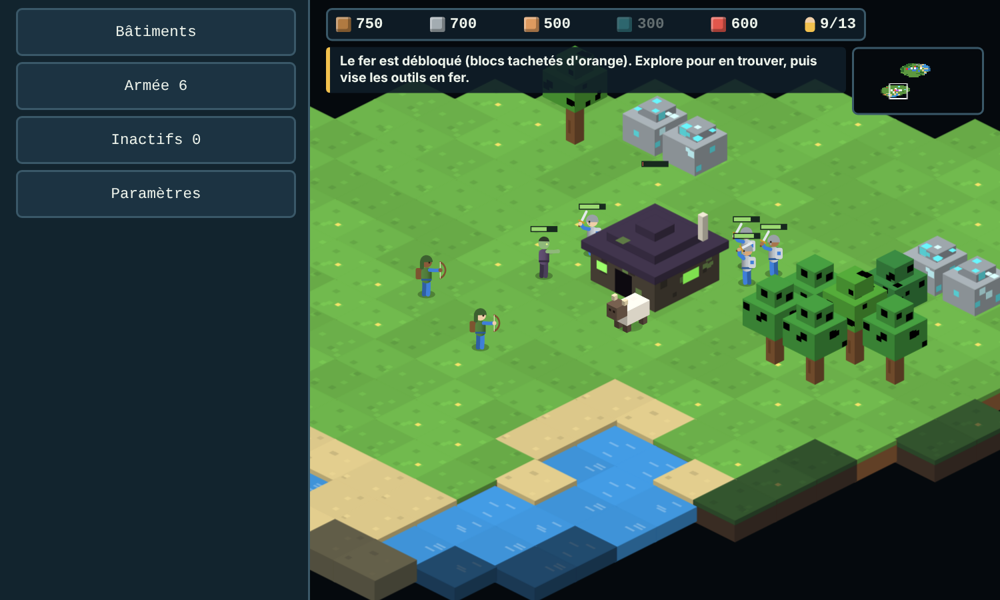
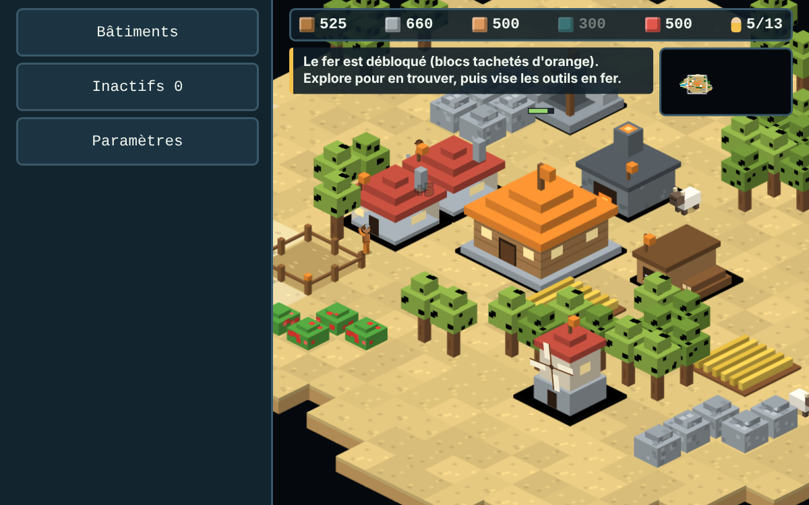
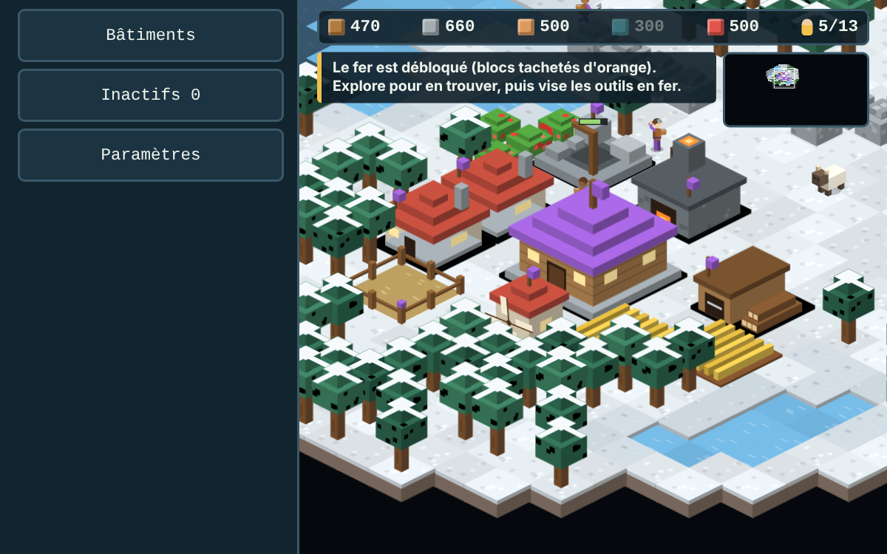
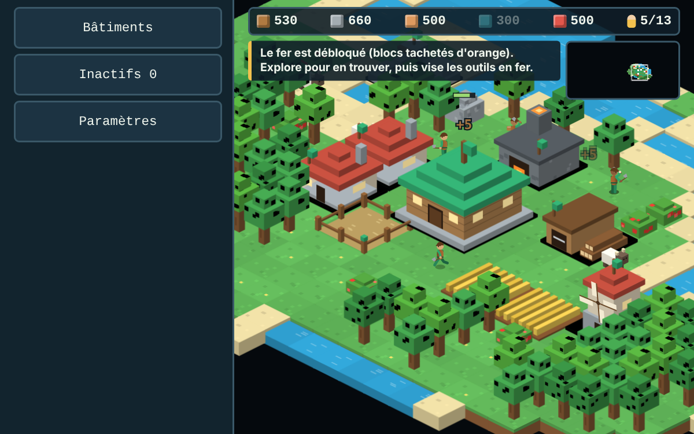

  

# Age of Blocks

Un jeu de stratégie en temps réel façon *Age of Empires*, dans un monde en blocs. Tout le jeu tient dans **un seul fichier HTML** : rien à installer, il se lance dans le navigateur d'un téléphone ou d'un PC.

**▶ Jouer :** https://gt61113.github.io/age-of-blocks/ *(une fois GitHub Pages activé, voir [plus bas](#mettre-le-jeu-en-ligne-github-pages))*

*Un village bien avancé. Au centre, le bâtiment principal au toit bleu (la couleur du joueur). Autour : maisons, forge, scierie, champs et moulin, caserne, tour et remparts. Le grand personnage gris est le gardien de fer.*

## Le principe

Tu démarres avec un centre du village, trois ouvriers, 120 de bois et 100 de nourriture, sur une carte tirée au hasard et couverte par le brouillard de guerre. Il faut récolter, construire, améliorer ses outils à la forge, se défendre, puis bâtir la **Merveille** pour gagner.

Les cinq ressources se débloquent l'une après l'autre grâce aux outils :

| Outils (à la forge) | Coût | Ce que ça débloque |
|---|---|---|
| Outils en bois | 60 bois | La pierre |
| Outils en pierre | 60 bois, 60 pierre | Le fer |
| Outils en fer | 60 bois, 60 fer | Le diamant |
| Outils en diamant | 40 fer, 40 diamant | Récolte deux fois plus rapide qu'à mains nues |

La nourriture vient des buissons à baies, des champs, de la chasse et de l'élevage en enclos.

## L'écran d'accueil

*Tout se règle avant la partie. Ici, le mode « Contre l'ordinateur » est choisi, avec le niveau de l'IA.*

- **Mode de jeu** : solo libre, **contre l'ordinateur** ou à deux (chacun sur son téléphone).
- **Difficulté** (solo libre et à deux) : la quantité qu'un ouvrier rapporte par trajet (10 en facile, 5 en normal, 1 en difficile). Elle ne se change plus une fois la partie lancée.
- **Niveau de l'ordinateur** (mode contre l'IA) : facile, normal ou difficile. Plus il est fort, plus il se développe vite et plus il attaque tôt (vers 14, 10 ou 7 minutes).
- **Taille de carte** : petite (48 × 48), moyenne (64 × 64) ou grande (80 × 80).
- **Paysage** : forêt, désert, neige ou îles.
- **Couleur du joueur** : six couleurs, visibles sur les toits, les drapeaux et les vêtements.

## Sur téléphone

  

*Sur téléphone, les ressources sont en haut et les menus en bas. Ici le menu Bâtiments est ouvert : il ne montre que ce que tes outils permettent déjà de construire. Sur PC, les menus passent à gauche.*

## Commandes

| Action | Téléphone | PC |
|---|---|---|
| Déplacer la carte | Glisser un doigt | Glisser à la souris |
| Zoomer | Pincer à deux doigts | Molette |
| Récolter | Toucher un arbre, un rocher, un buisson | Cliquer dessus |
| Donner un ordre précis | Toucher un ouvrier, puis sa cible | Idem |
| Construire | Menu Bâtiments, placer le plan, Valider | Idem |
| Sélectionner l'armée | Bouton Armée, ou double appui sur un soldat | Idem, ou Maj + glisser pour encadrer |

Dans **Paramètres**, deux réglages :

- **Commande des ouvriers** : automatique (l'ouvrier libre le plus proche y va) ou manuelle (un ouvrier, puis sa cible).
- **Ouvrier attaqué** : se défendre avec son outil, ou fuir se réfugier au village.

## Les bâtiments

| Bâtiment | Coût | Rôle | Disponible avec |
|---|---|---|---|
| Centre du village | au départ | Dépôt de tout, forme les ouvriers, refuge | — |
| Maison | 30 bois | +4 habitants | dès le début |
| Scierie | 50 bois | Dépôt de bois | dès le début |
| Forge | 80 bois | Fabrique les outils, palier par palier | dès le début |
| Champ | 40 bois | Nourriture inépuisable, deux fermiers au plus | dès le début |
| Enclos | 60 bois | Les animaux capturés s'y reproduisent | dès le début |
| Carrière | 80 bois | Dépôt de pierre | outils en bois |
| Moulin | 60 bois, 40 pierre | Dépôt de nourriture, +50 % pour les champs voisins | outils en bois |
| Caserne | 80 bois, 60 pierre | Forme les soldats | outils en bois |
| Rempart | 5 pierre par case | Bloque le passage | outils en bois |
| Porte | 10 bois, 5 pierre | Laisse passer tes ouvriers | outils en bois |
| Tour | 10 bois, 25 pierre | Tire des flèches sur les ennemis à portée | outils en bois |
| Mine | 60 bois, 60 pierre | Dépôt de fer et de diamant | outils en pierre |
| Écurie | 100 bois, 40 pierre | Forme les cavaliers | outils en pierre |
| **Merveille** | 300 bois, 300 pierre, 200 fer, 150 diamant | La terminer, c'est gagner | outils en fer |

La population est limitée à 50 habitants.

## Les personnages

| Unité | Coût | Où | Particularité |
|---|---|---|---|
| Ouvrier | 50 nourriture | Centre | Récolte, bâtit, chasse, élève |
| Fantassin | 40 nourriture, 20 bois | Caserne | Bâton et bouclier ; armure de fer et épée après amélioration (100 fer, 50 bois) |
| Archer | 30 nourriture, 30 bois, 10 fer | Caserne (outils en pierre) | Tire à distance |
| Cavalier | 60 nourriture, 30 bois, 20 fer | Écurie (outils en pierre) | Rapide et robuste, il frappe deux fois plus fort les archers |
| Promeneur | 60 nourriture | Centre (outils en pierre) | Explore la carte tout seul |
| Gardien de fer | 200 fer, 100 pierre | Forge (outils en pierre) | Un seul par village, il patrouille et le protège |

*Des cavaliers (à cheval) prêts au combat, aux côtés de fantassins et d'archers.*

## Les dangers

*Des fantassins en armure attaquent une cabane de zombies. Les barres vertes sont les points de vie.*

- **Loups** : ils rôdent loin du village et attaquent les ouvriers isolés. On peut les chasser pour leur viande.
- **Cabanes de zombies** : 2, 3 ou 4 selon la taille de la carte. Un zombie en sort toutes les 5 secondes (5 au maximum par cabane) tant qu'elle tient debout. La détruire rapporte 60 de fer et 30 de diamant.

## Les paysages

| Désert | Neige | Îles |
|---|---|---|
|  |  |  |

Chaque paysage change les couleurs, mais aussi la quantité d'eau, de forêt, de rochers et de loups.

## Contre l'ordinateur

Choisis **Contre l'ordinateur** sur l'écran d'accueil, puis le niveau de l'IA. L'ordinateur développe son propre village, récolte, construit, forme une armée et finit par attaquer. Pour gagner, détruis son centre du village ou termine ta Merveille avant lui. Plus le niveau est élevé, plus il se développe vite et plus son attaque arrive tôt.

## Jouer à deux

1. Les deux joueurs ouvrent le jeu, chacun sur son appareil, avec une connexion internet.
2. Le premier touche **À deux → Créer une partie** : un code de 4 lettres s'affiche.
3. Le second touche **À deux → Rejoindre** et tape ce code.

Pour gagner : détruire le centre du village adverse, ou terminer sa Merveille le premier. La partie est sauvegardée sur l'appareil de celui qui l'a créée ; il peut la reprendre plus tard avec un nouveau code.

La liaison se fait en direct entre les deux appareils quand c'est possible, sinon par un relais internet public.

## Sauvegarde

La partie solo est enregistrée automatiquement dans le navigateur. Le bouton **Reprendre la partie** apparaît à l'accueil. Vider les données du navigateur efface la sauvegarde.

## Côté technique

- Un seul fichier, `index.html` : HTML, CSS et JavaScript, sans moteur de jeu ni étape de compilation.
- Rendu isométrique dessiné dans un `<canvas>` ; tous les bâtiments, personnages et décors sont dessinés par le code, il n'y a aucune image.
- Musique et bruitages générés en direct par le navigateur (Web Audio).
- Jeu à deux : liaison directe WebRTC (bibliothèque PeerJS, chargée seulement dans ce mode), avec repli sur un relais MQTT public.
- Les polices viennent de Google Fonts ; sans connexion, le jeu utilise celles de l'appareil.

## Fichiers

| Fichier | Contenu |
|---|---|
| `index.html` | Le jeu complet (version 4) |
| `docs/logo.svg` | Le logo |
| `docs/*.png` | Les captures d'écran de cette page |

## Historique

- **v1** : récolte, construction, forge, Merveille.
- **v2** : écran d'accueil et logo, paysages, brouillard de guerre, tailles de carte, difficulté, loups, tours qui tirent, enclos.
- **v3** : caserne, fantassins, archers, promeneur, gardien de fer, cabanes de zombies.
- **v3.1** : jeu à deux, musique et bruitages.
- **v4** : mode contre l'ordinateur (IA avec trois niveaux), écurie et cavaliers.

---

*Age of Blocks est un projet personnel, sans lien avec Mojang, Microsoft ni la série Age of Empires.*
